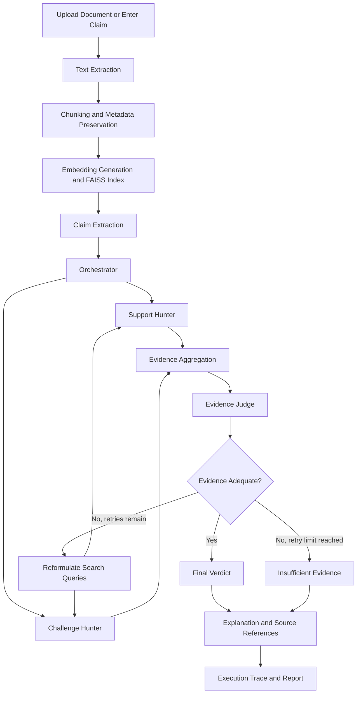

# ClaimCheck Agent
### An Agentic AI System for Bidirectional Evidence Investigation and Self-Correcting Claim Verification

**Domain:** Agentic AI · Generative AI · NLP · Retrieval-Augmented Generation (RAG) · Explainable AI

---

## 1. Overview

ClaimCheck Agent is an Agentic AI system designed to verify factual claims in documents by investigating evidence from both supporting and opposing perspectives.

Traditional Retrieval-Augmented Generation (RAG) systems retrieve relevant passages and generate answers based on them. However, finding a relevant passage does not necessarily prove that a claim is correct. A system may overlook contradictory evidence, interpret a passage without sufficient context, or produce a confident conclusion when the available evidence is incomplete.

ClaimCheck Agent addresses this problem through **bidirectional evidence investigation, evidence-based judgement, and bounded self-correction**.

The system extracts factual claims from documents or accepts manually entered claims, retrieves evidence that supports and challenges each claim, evaluates the quality and relevance of the evidence, and produces a transparent verdict with supporting explanations and source references.

When evidence is inadequate, the orchestrator can reformulate search queries and retry the investigation within a predefined limit. The system also maintains an execution trace so users can inspect how the final verdict was reached.

## 2. Problem Statement

AI-generated reports, research papers, technical documentation, and other information-rich documents may contain unsupported statements, exaggerated conclusions, misleading comparisons, or claims that conflict with the available evidence.

Conventional document question-answering systems often focus on retrieving relevant information rather than systematically investigating both sides of a factual claim. They may fail to identify contradictory passages or distinguish a lack of evidence from evidence that a claim is false.

There is a need for an evidence-grounded verification system that actively searches for supporting and challenging evidence, assesses whether the evidence is sufficient, recovers from weak retrieval results, and explains its conclusions transparently.

## 3. Proposed Solution

ClaimCheck Agent combines retrieval, specialized investigation roles, structured evidence assessment, and conditional retry logic within a controlled agentic workflow.

The system provides:

- **Claim Extraction:** Identifies factual claims in uploaded documents.
- **Support Hunter:** Searches for evidence that supports a claim.
- **Challenge Hunter:** Searches for counterevidence, contradictions, limitations, and exceptions.
- **Evidence Judge:** Assesses evidence relevance, context, support, contradiction, and sufficiency.
- **Self-Correction:** Reformulates search queries and retries when evidence is inadequate.
- **Transparent Verdicts:** Returns a verdict with evidence excerpts, explanations, and available source references.
- **Execution Trace:** Records retrieval attempts, queries, evidence, retry decisions, and final results.
- **Grounded Claim Revision:** Optionally suggests a more cautious claim when the available evidence supports a narrower statement.

The agents can be implemented as specialized Python modules coordinated by one orchestrator. Separate AI models for each role are not required.

## 4. Objectives

1. Extract verifiable factual claims from user-provided documents.
2. Retrieve evidence from relevant document passages.
3. Investigate claims from both supporting and opposing perspectives.
4. Distinguish supported claims, contradicted claims, and claims with insufficient evidence.
5. Implement bounded query reformulation and conditional retries.
6. Preserve source provenance for evidence and verdicts.
7. Provide an inspectable trace of the verification process.
8. Evaluate whether bidirectional investigation and self-correction improve verification performance compared with a single-pass RAG baseline.

## 5. System Architecture



The retry loop is bounded to prevent endless investigation. A well-supported Contradicted verdict is a valid outcome and does not trigger another retry merely because the claim is false.

## 6. How It Works

### Step 1: Document Ingestion

The user uploads a PDF, TXT, or DOCX file, or enters text directly. The system extracts text and preserves source information such as document names and PDF page numbers wherever available.

### Step 2: Text Chunking and Indexing

Extracted text is divided into manageable passages. Sentence Transformers generates embeddings, which are indexed using FAISS for semantic similarity search.

Each chunk retains its source metadata to help the system trace retrieved evidence back to its origin.

### Step 3: Claim Extraction

The Claim Extractor identifies factual statements suitable for verification. Claims can include numerical statements, comparisons, causal statements, and general factual assertions.

### Step 4: Bidirectional Evidence Investigation

The orchestrator coordinates two complementary investigation roles:

- **Support Hunter:** Retrieves passages that may support the original claim.
- **Challenge Hunter:** Retrieves passages that may contradict, qualify, or limit the claim.

The two evidence collections are combined, deduplicated, and passed to the Evidence Judge.

### Step 5: Evidence Assessment

The Evidence Judge examines the claim alongside the retrieved passages. It evaluates whether the evidence actually supports or contradicts the claim, whether relevant context is preserved, and whether the available evidence is sufficient to reach a conclusion.

### Step 6: Bounded Self-Correction

If the retrieved evidence is inadequate, the orchestrator can reformulate the search queries and retry retrieval. The proposed MVP allows up to two additional attempts after the initial investigation.

The original claim remains unchanged throughout the process. Only the search queries are reformulated.

### Step 7: Verdict Generation

The system produces one of three outcomes:

| Verdict | Meaning |
|---|---|
| **Supported** | The available evidence adequately supports the claim. |
| **Contradicted** | The available evidence adequately conflicts with the claim. |
| **Insufficient Evidence** | The available evidence does not justify either conclusion. |

### Step 8: Results and Audit Trace

The user receives the verdict, explanation, supporting and challenging evidence, available source references, and the investigation history. Results can be exported for further review.

## 7. Key Features

- PDF, TXT, DOCX, and pasted-text input.
- Manual single-claim verification.
- Automatic factual claim extraction.
- Bidirectional evidence retrieval.
- Semantic search using embeddings and FAISS.
- Structured evidence assessment.
- Bounded retry and query-reformulation logic.
- Three-way claim classification.
- Source-aware evidence display.
- Inspectable agent activity and execution trace.
- JSON and CSV result export.
- Optional PDF report generation.
- Evaluation against labelled verification examples.

Features are planned in stages; the current implementation status should be updated as each feature is completed and tested.

## 8. Technology Stack

| Component | Technology | Purpose |
|---|---|---|
| Programming language | Python | Application logic and orchestration |
| User interface | Streamlit | Document upload, investigation, and results |
| LLM | Gemini API | Claim extraction, query generation, and evidence assessment |
| PDF processing | PyMuPDF | Text extraction and page references |
| DOCX processing | python-docx | Word document extraction |
| Embeddings | Sentence Transformers | Semantic representations of evidence passages |
| Vector search | FAISS CPU | Similarity-based evidence retrieval |
| Data validation | Pydantic | Structured inputs and outputs |
| Data processing | Pandas | Dataset preparation and metric calculation |
| Testing | pytest | Unit and integration testing |
| Report generation | ReportLab | Optional downloadable PDF reports |
| Version control | Git and GitHub | Source control and collaboration |

## 9. Dataset

### Primary Dataset: SciFact

SciFact is a scientific claim-verification dataset containing claims, scientific abstracts, evidence annotations, and verification labels. It is suitable for evaluating evidence-based verification on scientific statements.

- **Official repository:** https://github.com/allenai/scifact
- **Hugging Face dataset:** https://huggingface.co/datasets/allenai/scifact

The initial implementation should use a small subset of approximately 100–200 labelled claims and their associated evidence abstracts, rather than downloading or processing a large corpus unnecessarily.

The dataset's evidence annotations and labels can help evaluate whether the system identifies relevant evidence and reaches appropriate verdicts. Dataset labels should be mapped carefully to the application's three verdict categories.

### Small Development Dataset

A small fictional library-policy document can be used during early development to test known cases before integrating SciFact.

Example facts include library opening hours, book borrowing limits, loan periods, and identification requirements. Test cases should cover Supported, Contradicted, and Insufficient Evidence outcomes.

### Dataset Limitations

SciFact focuses on scientific claim verification. It does not independently establish the truth of every claim across all domains. Performance on a small subset should be described as preliminary rather than as evidence of general-purpose verification accuracy.

Dataset licences, usage terms, and the selected subset's format should be checked before redistribution.

## 10. Project Novelty and Research Contribution

The proposed contribution is the **integration and empirical evaluation of bidirectional evidence investigation, evidence-sufficiency checks, bounded self-correction, and an inspectable execution trace within one claim-verification workflow**.

The project does not assume that these individual techniques are entirely new. Instead, it investigates whether combining them improves verification reliability and evidence traceability compared with a simpler retrieval-and-judgement pipeline.

### Research Question

Does bidirectional evidence investigation with bounded self-correction improve claim-verification reliability and citation correctness compared with a single-pass RAG baseline?

### Research Hypothesis

A verification workflow that retrieves both supporting and challenging evidence and retries inadequate investigations may reduce unsupported conclusions and improve evidence coverage compared with single-pass retrieval.

This hypothesis must be tested using labelled examples; improvement should not be claimed until results support it.

## 11. Evaluation Methodology

Evaluate three configurations using the same labelled test examples:

| Configuration | Description |
|---|---|
| **Baseline A** | Single-pass evidence retrieval and judgement |
| **Baseline B** | Bidirectional evidence investigation without retries |
| **Proposed System** | Bidirectional investigation with bounded self-correction |

### Evaluation Metrics

- **Macro-F1:** Measures classification performance across the three verdict categories.
- **Citation Correctness:** Measures whether cited passages genuinely support the explanation and are linked to the correct source.
- **Evidence Retrieval Recall:** Measures whether relevant annotated evidence is retrieved.
- **Recovery Success Rate:** Measures how often an initially inadequate investigation reaches a justified verdict after retries.
- **Average Tool Calls:** Measures the additional investigation cost.

Use a fixed test split where possible, document the evaluation settings, and calculate all reported values from actual runs. Do not fabricate scores or treat LLM-generated confidence as proof of correctness.

## 12. Project Structure

```text
ClaimCheck-Agent/
├── app.py
├── requirements.txt
├── .env.example
├── .gitignore
├── README.md
├── agents/
│   ├── claim_extractor.py
│   ├── planner.py
│   ├── support_hunter.py
│   ├── challenge_hunter.py
│   ├── evidence_judge.py
│   └── self_correction.py
├── tools/
│   ├── pdf_parser.py
│   ├── text_chunker.py
│   ├── vector_search.py
│   ├── evidence_validator.py
│   └── report_generator.py
├── core/
│   ├── orchestrator.py
│   ├── schemas.py
│   ├── prompts.py
│   └── audit_logger.py
├── evaluation/
│   ├── test_cases.json
│   ├── run_evaluation.py
│   └── metrics.py
├── tests/
│   ├── test_parser.py
│   ├── test_retrieval.py
│   └── test_recovery.py
└── data/
    └── sample_documents/
```

Files may be added or reorganized as the implementation evolves. The README and project structure should reflect the actual repository state.

## 13. Installation and Setup

### Prerequisites

- Python 3.10 or a compatible version supported by the selected dependencies.
- Git.
- A Gemini API key.
- Internet access for installing dependencies and accessing the configured API.

### Step 1: Clone the Repository

```bash
git clone <YOUR_GITHUB_REPOSITORY_URL>
cd ClaimCheck-Agent
```

Replace the placeholder with the repository's actual URL.

### Step 2: Create a Virtual Environment

Windows:

```bash
python -m venv .venv
.venv\Scripts\activate
```

macOS or Linux:

```bash
python3 -m venv .venv
source .venv/bin/activate
```

### Step 3: Install Dependencies

```bash
pip install -r requirements.txt
```

### Step 4: Configure the API Key

Create a `.env` file in the project root:

```env
GEMINI_API_KEY=your_actual_api_key
```

Load the key from the environment in the application. Never commit `.env` or expose API keys in source code, logs, screenshots, or public repositories.

### Step 5: Run the Application

```bash
streamlit run app.py
```

The application should open in the browser using Streamlit's local development server.

### Step 6: Run Tests

```bash
pytest -q
```

These commands describe the intended setup. Confirm that they work with the current implementation and installed dependency versions.

## 14. Usage

1. Launch the Streamlit application.
2. Upload a supported document or enter a factual claim manually.
3. Select the available evidence corpus or provide evidence text.
4. Start the investigation.
5. Review the supporting and challenging evidence.
6. Inspect the verdict and its explanation.
7. Examine the execution trace to see retrieval attempts and any retries.
8. Export the results if report generation is available.

The application should clearly indicate when evidence is missing, retrieval fails, or a result cannot be verified. It should not silently replace missing evidence with invented sources.

## 15. Limitations

- The quality of verification depends on the quality, relevance, and completeness of the available evidence corpus.
- Internal document retrieval cannot establish whether a claim is true in the wider world unless suitable external evidence is also available.
- LLM-based evidence assessment can produce errors, including incorrect interpretations of numerical results, qualifications, or causal relationships.
- Source citations establish where a passage was found; they do not automatically prove that the passage supports the claim.
- A small SciFact subset is suitable for an MVP but insufficient for strong generalization claims.
- Query retries can improve retrieval but may increase latency and API usage.
- Scanned PDFs may require OCR, which is outside the initial implementation unless explicitly added.
- The system is an evidence-assistance tool, not a replacement for expert judgement in high-stakes decisions.

## 16. Future Enhancements

- External web search for evidence beyond uploaded documents.
- Cross-document contradiction detection.
- Improved claim decomposition for complex statements.
- OCR support for scanned documents.
- Additional public claim-verification datasets.
- More rigorous source reliability and temporal-validity assessment.
- Claim dependency graphs for multi-step verification.
- User-defined evidence collections and reusable indexes.
- Advanced evaluation of citation entailment and retry efficiency.
- Optional human review and correction of generated verdicts.

## 17. Responsible Use

ClaimCheck Agent should distinguish between a claim being contradicted and a claim lacking sufficient evidence. It should preserve relevant qualifications and context, avoid fabricated citations, and disclose uncertainty when evidence is incomplete.

Users should review important conclusions against the original sources. Verification results depend on the available documents and the system's interpretation of them.

## 18. Project Status

**Development stage:** Initial MVP / active development.

Planned milestones:

- [ ] Repository scaffold and sample test corpus.
- [ ] Document ingestion and source metadata preservation.
- [ ] Semantic indexing and evidence retrieval.
- [ ] Claim extraction and structured schemas.
- [ ] Support Hunter and Challenge Hunter.
- [ ] Evidence Judge and three-way verdicts.
- [ ] Bounded self-correction and execution trace.
- [ ] Streamlit results interface and exports.
- [ ] SciFact subset integration.
- [ ] Baseline comparison, evaluation, and tests.

Update this checklist as features are implemented and verified.

---

## 19. Conclusion

ClaimCheck Agent proposes an agentic approach to claim verification that goes beyond retrieving relevant passages. By investigating both supporting and challenging evidence, assessing evidence sufficiency, retrying inadequate searches within a defined limit, and exposing an execution trace, the system aims to make document verification more transparent and reliable.

Its effectiveness will be assessed by comparing a single-pass baseline with bidirectional and self-correcting configurations on labelled claim-verification examples.

**ClaimCheck Agent — Investigate both sides. Verify with evidence. Explain every verdict.**